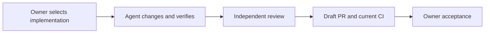

# PR presentation

Use Markdown as a reading aid. Pick features that explain the change; a small PR can be clear with a paragraph and links. Keep the main view short enough to reveal the result, evidence limits, and next action without opening disclosures.

## Choose a view

| Content | Useful presentation |
| --- | --- |
| Changed behavior | A concrete before/after example or a small `diff` block |
| Sequence or interaction | A Mermaid flowchart or sequence diagram |
| Responsibilities | A shallow file/component tree with roles |
| Alternatives or related outcomes | A compact table with short cells |
| Human actions | A short ordered list; task boxes only when tracking real actions |
| Visible behavior | A real screenshot, before/after pair, or recording with a caption |
| Exact commands or output | A fenced block with the appropriate language |
| Long technical evidence | A `<details>` block with a descriptive `<summary>` |
| A consequential limitation | One GitHub alert, or a clearly labelled visible paragraph |

Use `##` sections and `###` subsections with meaningful names. Use bold to identify a result or decision. Use descriptive links, including commit permalinks for evidence tied to a revision. An optional contents list helps only when a long body genuinely needs navigation.

## Diagrams read on their own

Start at the real trigger. Name actors by their role and show what each connection carries. Include hops that change the behavior; explain a rewrite or permission boundary where it occurs. Keep only participants and states needed for this change.

For example, translate labels into the team language:



Use one diagram when it replaces a longer explanation. Prefer familiar shapes and short labels. A diagram shows a process or model; label it as such rather than presenting it as execution evidence.

## Disclosures

Keep blank lines around Markdown inside HTML so GitHub renders lists, tables, and code correctly.

````markdown
<details>
<summary>Commands and checked revisions</summary>

| Check | Result |
| --- | --- |
| `pnpm check` | <actual result> |

```text
<brief relevant output>
```

</details>
````

Keep the conclusion, required human checks, blockers, and material uncertainty visible. Collapse the supporting detail once; nested disclosures make evidence harder to find.

## Visual evidence and emphasis

Give images meaningful alt text and a caption naming the scenario and observed result. Explain what a recording demonstrates. Link to real accessible artifacts; do not invent screenshots, upload URLs, or status badges. A UI image can show a hidden button while the API still permits the action.

Use GitHub alerts sparingly for information that changes the acceptance decision:

```markdown
> [!IMPORTANT]
> <material limitation or decision the owner needs before acceptance>
```

Let native GitHub CI checks carry live status. Any status in the body describes a named run and revision. Colour, emoji, or a badge alone must not carry the meaning.

## Check the rendering

Use the GitHub preview or rendered PR when available. Inspect diagram rendering, table wrapping, disclosure expansion, links, and image captions. If rendering cannot be inspected, state that limitation and use a simple fallback for unsupported elements.

GitHub references: [basic formatting and alerts](https://docs.github.com/en/get-started/writing-on-github/getting-started-with-writing-and-formatting-on-github/basic-writing-and-formatting-syntax), [collapsed sections](https://docs.github.com/en/get-started/writing-on-github/working-with-advanced-formatting/organizing-information-with-collapsed-sections), [diagrams](https://docs.github.com/en/get-started/writing-on-github/working-with-advanced-formatting/creating-diagrams). Verified 2026-11-03.
