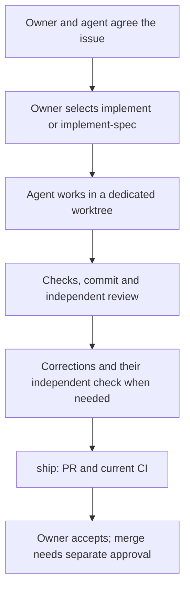

# Working with this harness

[Русский](process.ru.md)

This human guide explains the agent rules; it adds no authority.
Issue means a tracked task. Spec means an agreed change description with scenarios and acceptance criteria.
Worktree means a separate working copy with its own branch. CI means automated repository checks.

## Choose the route

| Situation | Preparation | Implementation |
| --- | --- | --- |
| Clear small task | Short issue with result, boundaries, criteria and verification | Owner selects `implement` |
| Idea with open decisions | Discuss; research or prototype when needed | Start after agreeing the bounded change |
| Large change | `to-spec`; `to-tickets` when slices need dependencies | `implement-spec`, or individual tickets through `implement` |
| Unclear bug | `diagnosing-bugs` gathers reproduction and cause | Diagnosis alone does not authorize a fix |
| Quick fix | Short issue; a full spec is usually unnecessary | The same worktree and verification rules apply |

Naming the skill in ordinary language is sufficient: “Use implement for issue 12.”
An unnamed implementation request gets a proposed route rather than an automatic start.

## Where behavior is described

A spec answers “what was requested then, and why”. After merge, nobody rewrites it.
In a project that adopts this harness, the project’s tests show current behavior.
That project keeps no separate document of current behavior.
`DOMAIN.md` holds terms. ADRs hold consequential decisions.
A new issue links the earlier one and names each criterion it replaces.
[Requirements](agents/requirements.md#current-behavior-and-history) list the source for each question.
This repository has no application tests; `docs/requirements.en.md` and `docs/requirements.ru.md` describe its scope.

## Review and corrections

`code-review` starts independent Standards and Spec reviewers; they return reports rather than edit files.
With `implement`, the main session makes corrections.
With `implement-spec`, one fresh implementer corrects the integrated result.
Then affected checks and an independent review cover the corrections and relevant interactions.
The earlier full review remains part of the evidence.
Optional improvements do not create another required cycle or expand the assignment.
Disputed decisions or rounds without progress return to the owner.
There is currently no numerical cap or separate arbitration mechanism.

## Larger specs

The main session treats tickets as a dependency graph.
Ready independent tickets run in their own worker worktrees.
Merges to the integration branch happen serially.
Workers use `tdd`; the aggregate integration result receives `code-review`.
A spec opens a draft PR after its first integrated result and reuses it.
One final PR may close the spec and several tickets.

## Human participation

When preparing the issue or spec, agree any additional human checks.
Choose them by consequences and missing evidence, not diff size alone.
Permissions, destructive actions, business rules, consequential UX, architecture, CI and agent authority can require focused inspection.
Before handoff, the independent Spec reviewer checks whether a human question was omitted.

For each human check, explain the changed behavior, plausible failure, consequence, role, action and expected result.
Show what automated checks already establish and what remains uncertain.
Say when the decision is needed and which work waits for it.
Every PR still receives final owner acceptance even when no extra manual test is needed.

## Delivery

`ship` pushes the reviewed branch and uses `pr` for its description.
It creates or updates a draft, waits for current CI and hands the result to the owner.
Small tasks open drafts after local checks and review; specs reuse their earlier draft.
CI fixes stay within the assignment and receive affected checks and review.
Acceptance and merge approval are separate; an agent’s authorized merge checks the approved head SHA.
Worktrees separate files, not credentials or shared services.

## Develop the example

Start with ordinary tasks and record friction before adding rules.
[Experiments](experiments.en.md) lists proposed comparisons; none is presented as completed evidence.
The pinned Matt `implement-spec` requires a fresh correction implementer but does not mandate re-review.
Our correction verification and verified-PR delivery are local choices.
